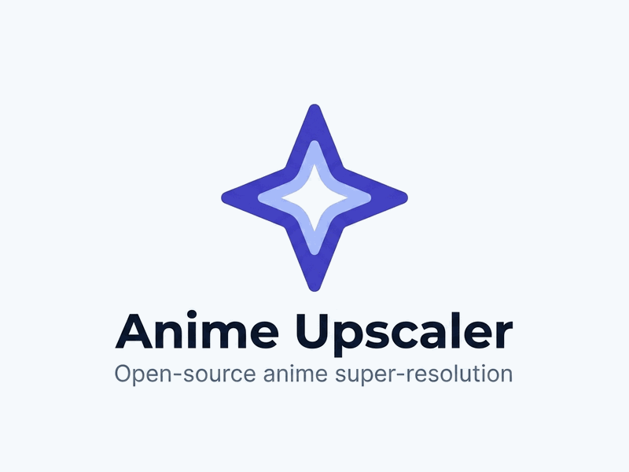
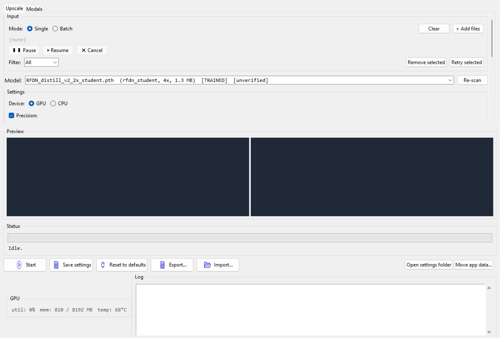
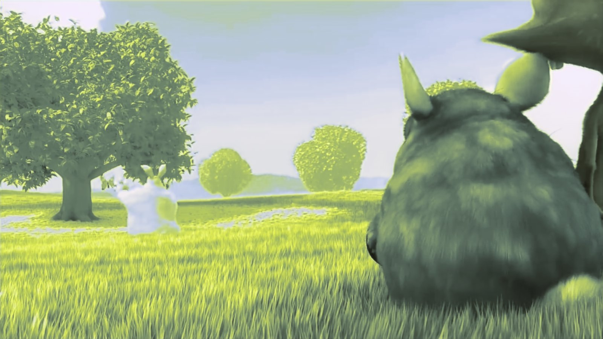
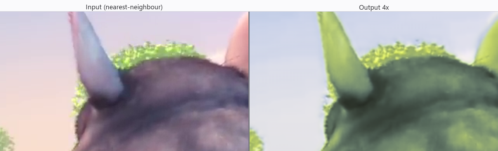
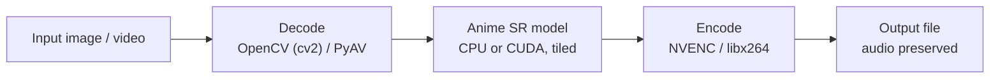
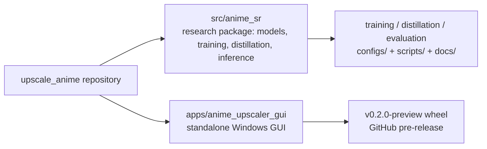

English | [العربية](README.ar.md)

# Anime Upscaler GUI & Anime Super-Resolution Toolkit (PyTorch)

[](https://github.com/alshahia/upscale_anime/actions/workflows/ci.yml?query=branch%3Arelease%2Fgui-preview)
[](https://github.com/alshahia/upscale_anime/releases/tag/v0.2.0-preview)
[](LICENSE)
[](pyproject.toml)
[](requirements.txt)

<p align="center">
  
</p>

Anime upscaling in PyTorch, shipped in two forms: a standalone **Windows anime upscaler GUI** for image and video upscaling, and a **research/training toolkit** (`anime_sr`) for anime super-resolution with SPAN, Mamba-PAN, and progressive ensemble knowledge distillation into lightweight RFDN/TinySRVGG students. Both share the same model code and a CPU/CUDA inference stack, with batch-queue processing, tiled inference for limited VRAM, and reproducible configuration files.

> **Status:** preview. The GUI is released as the GitHub pre-release [`v0.2.0-preview`](https://github.com/alshahia/upscale_anime/releases/tag/v0.2.0-preview); the research package is alpha source (not on PyPI). See [Status & limitations](#status--limitations).

## Table of contents

- [Visual overview](#visual-overview)
- [Two things in one repo](#two-things-in-one-repo)
- [Download & install the GUI (Windows)](#download--install-the-gui-windows)
- [GUI features](#gui-features)
- [Supported models](#supported-models)
- [Research: training & distillation](#research-training--distillation)
- [Benchmarks & measured results](#benchmarks--measured-results)
- [For researchers](#for-researchers)
- [For AI agents & LLM research](#for-ai-agents--llm-research)
- [Configuration](#configuration)
- [Development](#development)
- [Repository layout](#repository-layout)
- [Documentation](#documentation)
- [Status & limitations](#status--limitations)
- [License](#license)
- [Acknowledgments](#acknowledgments)

## Visual overview

<p align="center">
  
</p>

<p align="center"><sub>The standalone Windows GUI (<code>anime-upscaler-gui 0.2.0</code>, preview) captured from this repository's development environment. This is the real app with an empty queue: model weights are downloaded or imported separately, so the wheel ships no demo content.</sub></p>

### Before / after

The pair below is the repository's own documented demo sample: a 1280x720 frame from the project's `assets/examples/lr.png` and its 4x demo output `assets/examples/output.png`, downscaled for the web. It is a project demo from the repository, not a benchmark comparison; appearance and colour depend on the model and the sample.

| Input (1280x720) | Output 4x (5120x2880) |
|:--:|:--:|
|  |  |

<p align="center"><sub>Demo assets: <a href="assets/examples/lr.png"><code>assets/examples/lr.png</code></a> and <a href="assets/examples/output.png"><code>assets/examples/output.png</code></a> (4x upscale produced by the project). Numbers quoted elsewhere in this README are project-reported.</sub></p>

### Detail comparison (100% crop)

Both panels show the same 320x180 input region displayed at 640x360 for comparison: the left panel is the input enlarged with nearest-neighbour (so pixel blocks are visible), and the right panel is the corresponding 4x output downscaled to the same display size. It is included as an honest sample of the demo pair, not as a quality benchmark.

<p align="center">
  
</p>

### How the GUI pipeline works

Each job runs locally through one decode -> inference -> encode pipeline:



- **Standalone wheel.** The released wheel contains the GUI and model code; checkpoints are downloaded or imported through the **Models** tab. Nothing is sent to a server and no account is needed.
- **Hardware-aware.** CPU inference always works; CUDA is used when available, FP16 and tiled processing limit VRAM use, and the encoder falls back from NVENC to libx264 when hardware encoding is unavailable.
- **Video handling.** The original audio track is preserved, and long files are processed through the batch queue with pause/resume/cancel.

### Repository at a glance



One repository, two deliverables that share the same model code and CPU/CUDA inference stack — described in [Two things in one repo](#two-things-in-one-repo).

## Two things in one repo

| | Standalone GUI (released) | Research package (source) |
|---|---|---|
| What it is | Tkinter desktop app for upscaling images and videos: queue, preview, VRAM guard, batch processing | `anime_sr` PyTorch code for training, distillation, evaluation and deployment |
| Install | Wheel from the [v0.2.0-preview release](https://github.com/alshahia/upscale_anime/releases/tag/v0.2.0-preview) | `pip install -e ".[dev]"` from a source checkout |
| Version | `anime-upscaler-gui 0.2.0` (pre-release) | `anime-sr 0.1.0` (alpha, source only) |
| Entry points | `anime-upscaler-gui` / `anime-upscaler-gui --self-check` | `anime-sr` CLI, Python API, `scripts/` utilities |
| Status | Windows 11 tested for the release | research code; CI green on Ubuntu |

## Download & install the GUI (Windows)

The GUI is distributed as a single wheel on the pre-release page: [`v0.2.0-preview`](https://github.com/alshahia/upscale_anime/releases/tag/v0.2.0-preview).
Assets: `anime_upscaler_gui-0.2.0-py3-none-any.whl` (~3.0 MB) and `SHA256SUMS.txt`.

1. Download the wheel (and `SHA256SUMS.txt`) from the release.
2. Verify the download (optional but recommended):

   ```powershell
   Get-FileHash .\anime_upscaler_gui-0.2.0-py3-none-any.whl -Algorithm SHA256
   # Compare with the hash in SHA256SUMS.txt
   ```

3. Create a virtual environment and install the wheel:

   ```powershell
   python -m venv .venv-anime-gui
   .venv-anime-gui\Scripts\python.exe -m pip install anime_upscaler_gui-0.2.0-py3-none-any.whl
   ```

4. Run the environment self-check, then launch:

   ```powershell
   .venv-anime-gui\Scripts\anime-upscaler-gui.exe --self-check
   .venv-anime-gui\Scripts\anime-upscaler-gui.exe
   ```

**Prerequisites**

- **Windows 11** (the release was built and tested on Windows 11).
- **Python 3.10+** (3.12 recommended) for the wheel, or use a prebuilt environment.
- **`ffmpeg` and `ffprobe` on `PATH`** for video decoding/encoding; `--self-check` reports whether both are found.
- GPU is optional: CPU works, CUDA is used when available. An 8 GB GPU is the tuning target.

**No model weights are bundled.** The wheel ships the model code and a preset catalog only; checkpoints are downloaded or imported through the GUI's **Models** tab (catalog presets, custom URL, or a local file). See the [GUI README](apps/anime_upscaler_gui/README.md) for the walkthrough.

> The release is a **pre-release** (`v0.2.0-preview`) and not a production support commitment. The wheel is not on PyPI.

## GUI features

- **Image and video upscaling** with batch queue: add files/folders, pause, resume, cancel, reorder.
- **Live preview, log panel, and GPU monitor** while a job runs.
- **CPU/CUDA inference** with FP16, tiled processing, and a VRAM guard (warn / auto-downscale / tiled / off) aimed at 8 GB GPUs.
- **Model catalog** that auto-detects checkpoints in `pretrained/`, with built-in presets, custom URLs, and local imports.
- **Themes and accessibility**: light / dark / high-contrast palettes, keyboard shortcuts, English/Arabic UI, 800x600 minimum window.
- **Settings and queue persistence** outside the source tree (per-user app data folder).
- **Safe checkpoint loading** by default; the pickle fallback requires an explicit opt-in.

See the [GUI README](apps/anime_upscaler_gui/README.md) for shortcuts, settings, architecture extension recipes, and standalone deployment details.

## Supported models

The GUI bundles the model code for these kinds (the catalog can list additional unsupported architectures for visibility):

| Kind | Example checkpoints | Scale | License |
|---|---|---:|---|
| `srvgg` | realesr-animevideov3, 4xLSDIRCompactv2 | 4x | BSD-3 / CC-BY |
| `span` | span_pix_pretrain_4x, span_mssim_pretrain_4x | 4x | CC-BY-4.0 |
| `era` | eranet_N12_pretrain_325k | 2x | MIT |
| `animesr` | AnimeSR_v1, AnimeSR_v2 | 4x | Apache-2.0 |
| `rfdn_student` | RFDN_distill_v1_4x_student | 4x | Project-internal |
| `srvgg_student` | SRVGG_distill_v1_4x_student | 4x | Project-internal |

`rfdn_student` and `srvgg_student` are the in-house distilled lightweight students; the student checkpoints are downloaded separately (not bundled). Details, licensing notes, and the upstream attribution file are in the [GUI README](apps/anime_upscaler_gui/README.md).

## Research: training & distillation

The research package implements anime super-resolution training and knowledge distillation:

- **SPAN-Tiny** teacher (Swift Parameter-free Attention Network) with auxiliary losses; **SPAN-F** variant for higher quality.
- **Mamba-PAN** with 4-direction scanning (optional `mamba-ssm` extra; the SPAN-only path works without it).
- **Progressive ensemble distillation**: train multiple teachers, combine them into an ensemble meta-teacher, then distill into an ultra-lightweight student.
- **MTKD + FAKD**: multi-teacher knowledge distillation (wavelet-guided) and feature-affinity knowledge distillation losses.
- **Students**: RFDN (~600K params) and TinySRVGG (~317K params) for fast CPU/CUDA inference.
- **Data pipeline**: RealESRGAN-style degradation with presets (light/medium/heavy/anime), APISR-style two-stage compression (JPEG/WebP/AVIF/H.264/H.265), precomputed/hybrid preprocessing modes.
- **Inference extras**: tiled processing, D4 test-time augmentation (`--tta`), ONNX/TorchScript export, FastAPI server.

Install from a source checkout:

```bash
python -m venv .venv
.venv\Scripts\activate          # Windows; Linux/macOS: source .venv/bin/activate
pip install -e ".[dev]"         # development tools
pip install -e ".[api]"         # optional FastAPI server dependencies
pip install -e ".[mamba]"       # optional Mamba-PAN (mamba-ssm) support
```

CLI examples:

```bash
# Train (configs live in configs/; see docs/config_reference.md)
anime-sr train --config configs/base.yaml

# Inference on one image or a directory
anime-sr infer --checkpoint checkpoints/model_best.pt --input ./input_images --output ./output --scale 4
anime-sr infer --checkpoint checkpoints/model_best.pt --input ./input_images --output ./output --scale 4 --tta --tile 512

# Export, validate, benchmark, serve
anime-sr export --checkpoint ./checkpoints/model_best.pt --output ./exported/model.onnx --format onnx
anime-sr validate --checkpoint ./checkpoints/model_best.pt
anime-sr benchmark --checkpoint ./checkpoints/model_best.pt --input ./input_images/sample.png --iterations 10
anime-sr serve --config configs/api/default.yaml --host 127.0.0.1 --port 8000
```

Python API:

```python
from anime_sr.inference.engine import InferenceEngine

engine = InferenceEngine.from_checkpoint(
    checkpoint_path="./checkpoints/model_best.pt",
    model_type="span",      # 'span' | 'neosr_span' | 'mamba_pan' | 'tiny_student'
    device="cuda",          # or "cpu"
)
result = engine.process_image("input.png", "output.png", scale=4, tile_size=512)
```

More: [Training guide](docs/training.md) · [Model architectures](docs/models.md) · [CLI reference](docs/cli.md) · [Configuration](docs/configuration.md) · [API](docs/api.md).

> Demo checkpoints used by the docs are not released models. The v7 finetune and the v8 GPU evaluation are deferred to a user GPU, as stated in the linked reports.

## Benchmarks & measured results

These are engineering measurements reported by this project, on a single machine (Quadro RTX 4000 / RTX 4000 Mobile, Windows), not an independent benchmark suite. Values are copied from the linked documents; no new measurements are claimed here.

| Model | Params | Quality (reported) | Throughput (reported) | Evidence |
|---|---:|---|---|---|
| RFDN student (`rfdn_student`) | ~315K | 29.32 dB test PSNR | 2.49 fps end-to-end with D4 TTA + FP16 on 854x480 -> 3416x1920; 18.80-20.52 fps end-to-end with the TensorRT + NVENC path (Phase 1) | [report](docs/rfdn_realtime_report.md), [GUI README](apps/anime_upscaler_gui/README.md) |
| TinySRVGG student (`srvgg_student`) | 317K | 33.55 dB / 0.9146 SSIM on the held-out test split (bicubic 33.05), NIQE 7.38 | 51.8 fps vs 42.3 fps for `realesr-animevideov3`, at 2560x1440 output on a real 25 fps episode | [GUI README](apps/anime_upscaler_gui/README.md) |

- The RFDN real-time report includes the full per-stage breakdown and the Phase 1 TensorRT/NVENC assessment: [docs/rfdn_realtime_report.md](docs/rfdn_realtime_report.md).
- v7 comparison baselines (off-the-shelf SPAN pretrain and v4 finetune) are in [docs/v7_results.md](docs/v7_results.md); the v7 finetune itself was deferred.
- v8 TTA / model-souping code is shipped and tested; GPU evaluation was deferred: [docs/v8_results.md](docs/v8_results.md).
- Raw release-day measurements: [docs/status/MEASURED_STATUS_2026-11-16.md](docs/status/MEASURED_STATUS_2026-11-16.md).

## For researchers

The repository documents a full research pipeline rather than a single model:

- progressive ensemble distillation (teacher ensemble -> student), MTKD/FAKD losses, wavelet-guided and perceptual/adversarial loss stacks;
- SPAN and Mamba-based backbones, ERANet and AnimeSR inference paths, and Real-ESRGAN-style degradation for training;
- safe checkpoint handling (`weights_only=True` by default, explicit pickle opt-in), reproducible YAML configs, and CLI/API entry points for evaluation.

**Related work and upstream projects**

- SPAN — [Swift Parameter-free Attention Network](https://github.com/hongyuanyu/SPAN) ([paper](https://arxiv.org/abs/2311.12770))
- [Real-ESRGAN](https://github.com/xinntao/Real-ESRGAN) ([paper](https://arxiv.org/abs/2107.10833))
- [BasicSR](https://github.com/XPixelGroup/BasicSR)
- [neosr](https://github.com/muslll/neosr)
- [MambaIR](https://github.com/csguoh/MambaIR) ([paper](https://arxiv.org/abs/2402.15648); MambaIRv2: [arXiv:2411.15269](https://arxiv.org/abs/2411.15269))
- [spandrel](https://github.com/chaiNNer-org/spandrel)
- [AnimeSR](https://github.com/TencentARC/AnimeSR) ([paper](https://arxiv.org/abs/2206.07038))
- [APISR](https://github.com/Kiteretsu77/APISR) ([paper](https://arxiv.org/abs/2403.01598))
- [Phhofm/models](https://github.com/Phhofm/models) — source of the pretrained SPAN checkpoints used as warm starts.

**Citing this repository**

- Citation metadata: [`CITATION.cff`](CITATION.cff) (CFF 1.2.0); GitHub's **Cite this repository** button is powered by this file.
- How to cite the software and the key upstream papers: [`docs/citation.md`](docs/citation.md).
- BibTeX entries for the upstream papers are collected there; please also respect the upstream licenses and the attribution file at [`apps/anime_upscaler_gui/anime_upscaler_gui/_models/NOTICE.md`](apps/anime_upscaler_gui/anime_upscaler_gui/_models/NOTICE.md).

## For AI agents & LLM research

Machine-readable entry points are kept at the repository root so agents do not need to scrape the documentation site:

| File | Purpose |
|---|---|
| [`llms.txt`](llms.txt) | Compact machine-readable index of this repository ([llmstxt.org](https://llmstxt.org/) convention) |
| [`docs/llms.txt`](docs/llms.txt) | Documentation-site index with relative links |
| [`AGENTS.md`](AGENTS.md) | Concise instructions for coding agents: layout, commands, constraints |
| [`docs/AGENTS.md`](docs/AGENTS.md) | Detailed internal contributor/agent rules used during development |
| [`CITATION.cff`](CITATION.cff) | Citation metadata (CFF 1.2.0) |
| [`docs/citation.md`](docs/citation.md) | How to cite; BibTeX for the software and key papers |

Stable entry points:

| Interface | Entry point |
|---|---|
| CLI | `anime-sr` (`train`, `infer`, `export`, `serve`, `validate`, `benchmark`) |
| GUI | `anime-upscaler-gui` (wheel); `--self-check` prints a JSON environment report |
| Python API | `anime_sr.inference.engine.InferenceEngine`, `anime_sr.api.inference_api.create_app` |
| Scripts | `scripts/inference.py`, `scripts/train.py`, `scripts/release/rehearse_windows.ps1` |

Headless inference example:

```bash
pip install -e ".[dev]"
anime-sr infer --checkpoint checkpoints/model_best.pt --input ./input_images --output ./output --scale 4 --device cuda
```

Verification commands:

```bash
pytest                                    # research tests
pytest apps/anime_upscaler_gui/tests -q   # GUI tests
pytest tests/release -q                   # release/artifact guards
python -m mkdocs build --strict           # documentation site
```

Safety notes for automated use: checkpoints are loaded with `weights_only=True` by default. The research package gates the pickle fallback behind `security.allow_pickle_checkpoint` (env: `DSH_ALLOW_PICKLE_CHECKPOINT=true`); the GUI gates it behind `ANIME_UPSCALER_ALLOW_UNSAFE_PICKLE=1`. Only use these with trusted checkpoints.

## Configuration

### Environment variables

Copy `.env.example` to `.env` and adjust; the `DSH_*` prefix maps to config paths.

```bash
cp .env.example .env
```

| Variable | Default | Description |
|---|---|---|
| `DSH_API_KEY` | - | API authentication key |
| `DSH_MODEL_PATH` | `./checkpoints` | Path to model checkpoints |
| `DSH_OUTPUT_PATH` | `./output` | Path for output files |
| `DSH_LOG_LEVEL` | `INFO` | Logging level |
| `DSH_CUDA_VISIBLE_DEVICES` | `0` | GPU device IDs |
| `DSH_ALLOW_PICKLE_CHECKPOINT` | `false` | Allow pickle checkpoints (security; trusted files only) |
| `DSH_MAX_FILE_SIZE_MB` | `50` | Max upload size in MB |
| `DSH_RATE_LIMIT_PER_MIN` | `60` | API rate limit per minute |

### Training config

Training is configured with YAML files under `configs/`; see [docs/config_reference.md](docs/config_reference.md) and [docs/configuration.md](docs/configuration.md). Validate a config with `anime-sr train --config <file> --dry-run` before a long run.

## Development

```bash
pip install -e ".[dev]"
```

Tests:

```bash
pytest                                  # all tests configured in pyproject.toml
pytest -m "not slow"                    # skip slow tests
pytest -m integration                   # integration tests only
pytest tests/release -q                 # release artifact/packaging guards
pytest apps/anime_upscaler_gui/tests -q # GUI test suite (also runs in CI)
```

Documentation:

```bash
python -m mkdocs build --strict   # docs/ -> site/ (MkDocs Material)
python -m mkdocs serve            # local preview
```

Code quality (CI: syntax lint is blocking; full style/type lanes are advisory):

```bash
black src/
flake8 src/
mypy src/
```

## Repository layout

```text
upscale_anime/
├── src/anime_sr/              # research package: models, training, distillation, inference, API
├── apps/anime_upscaler_gui/   # standalone Tkinter GUI + its wheel build
├── configs/                   # YAML configs (training, API, finetuning)
├── scripts/                   # CLI utilities, evaluation, release rehearsal
├── tests/                     # research tests + tests/release guards
├── docs/                      # documentation site sources (MkDocs Material)
├── assets/                    # example images
├── .github/workflows/         # CI: tests, GUI, API smoke, integration, performance, docs, advisory security
├── pyproject.toml             # anime-sr 0.1.0 (research package)
└── apps/anime_upscaler_gui/pyproject.toml  # anime-upscaler-gui 0.2.0 (released wheel)
```

Generated/working directories (`data/`, `checkpoints/`, `pretrained/`, `output/`, `runs/`, `dist/`, `site/`, `.venv/`) are gitignored.

## Documentation

- [Documentation index](docs/index.md)
- [User guide](docs/USER_GUIDE.md) and [quick reference](docs/QUICK_REFERENCE.md)
- [CLI reference](docs/cli.md) and [configuration](docs/configuration.md)
- [Model architectures](docs/models.md) and [architecture overview](docs/architecture.md)
- [Training guide](docs/training.md)
- [Deployment](docs/deployment.md) and [public API](docs/PUBLIC_API.md)
- [Troubleshooting](docs/troubleshooting.md)
- [Citation guide](docs/citation.md) and [llms.txt](llms.txt) for machine consumption
- [GUI README](apps/anime_upscaler_gui/README.md)

## Status & limitations

- **Preview only.** The GUI is a `v0.2.0-preview` pre-release; the research package is alpha. Nothing here is production-supported.
- **Platforms.** The GUI release was built and tested on **Windows 11**; CI runs on Ubuntu Linux, so other desktop platforms are not validated for the packaged app.
- **No PyPI package.** The GUI wheel is distributed through the GitHub release only. The `publish-pypi` CI job is manual-only (it has never run), and no package is published to PyPI.
- **No bundled weights.** Model checkpoints are downloaded/imported separately; the demo checkpoints referenced in the docs are not released models.
- **Optional Mamba path.** Mamba-PAN needs the optional `mamba-ssm` extra; the SPAN path does not. The v7 opt-in path and the Windows-without-CUDA-kernel setup are exercised by the test suite.
- **Security scan is advisory.** CI's bandit security job is non-blocking and currently reports 40 pre-existing MEDIUM findings (39 legacy `torch.load` sites plus 1 `urlopen`), tracked as follow-up work. Checkpoints load safely by default; pickle loading requires an explicit opt-in.
- **Reported numbers are single-machine.** Benchmarks in the docs are project-reported measurements, not independently reproduced results.
- **Deferred work.** v7 finetune and v8 GPU evaluation are deferred to a user GPU; the Arabic GUI catalog has 35 hand-translated strings pending native-speaker review.
- **Track-2 follow-ups** (release pipeline hardening, legacy release-path retirement, broader platform validation) are tracked internally; the release path is reproducible via `python -m build` + `twine check` and the rehearsal script.

## License

MIT License - see [LICENSE](LICENSE).

## Acknowledgments

- [SPAN](https://github.com/hongyuanyu/SPAN) for the parameter-free attention architecture; [Real-ESRGAN](https://github.com/xinntao/Real-ESRGAN), [BasicSR](https://github.com/XPixelGroup/BasicSR) and [neosr](https://github.com/muslll/neosr) for training and degradation tooling.
- [MambaIR](https://github.com/csguoh/MambaIR) / MambaIRv2 for the state-space restoration blocks; [spandrel](https://github.com/chaiNNer-org/spandrel) for model/checkpoint interoperability.
- [Phhofm/models](https://github.com/Phhofm/models) for the pretrained SPAN checkpoints; [AnimeSR](https://github.com/TencentARC/AnimeSR) and [APISR](https://github.com/Kiteretsu77/APISR) for anime restoration references.
- Vendored model code attribution: [`apps/anime_upscaler_gui/anime_upscaler_gui/_models/NOTICE.md`](apps/anime_upscaler_gui/anime_upscaler_gui/_models/NOTICE.md).
